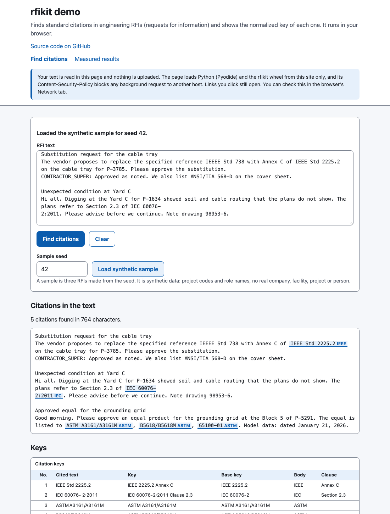

# rfikit

rfikit finds standard citations in engineering RFIs and returns normalized designation keys. RFI here means request for information, not radio-frequency interference.



## Who it is for

Engineers, project controls staff and analysts who have an RFI export (a CSV with an id, a subject and a question) and want to know which standards the questions cite, for example IEC 61439-1 or IEEE 80, each with a clean key you can count or join on. It handles designations and clause numbers only. It does not say whether a standard applies or what it requires.

## Quickstart

1. Install it (Python 3.11 or newer, no runtime dependencies):

```
python3 -m venv .venv
source .venv/bin/activate
pip install -e ".[dev]"
```

2. Make a synthetic corpus and score the extractor on it:

```
rfikit generate --seed 42 --n 600 --out data/
rfikit evaluate data/
```

3. Run it on your own export. A CSV needs the columns rfi_id, subject and question:

```
rfikit extract rfis.csv --out citations.csv
rfikit analyze rfis.csv --out results/
```

All commands run on your machine. The package imports no network or subprocess module; tests/test_no_network_imports.py checks that. The full command line, with input limits and output rules, is in [docs/cli.md](docs/cli.md).

## Demo

A static page runs rfikit in your browser with Pyodide. Paste RFI text to see each citation marked with its body name and a table of keys, or load a synthetic sample by seed. A second page shows the measured rates, labeled "measured on synthetic data". Pasted text is not uploaded, and the page requests nothing from other hosts.

The live page is at https://mehmetsean.github.io/rfi-analysis-system/. To build it on your machine instead:

```
pip install -e ".[dev,browser]"
python -m playwright install chromium
python scripts/build_site.py
python -m http.server 8000 --bind 127.0.0.1 --directory _site
```

The build downloads the Pyodide core archive once and checks it against pinned hashes. Details are in [ADR 12](docs/adr/0012-in-browser-demo.md).

## Measured results

Measured on synthetic data, for rfikit on report seeds 101 to 130 (sets A and B) and on the written set. The table is written from src/rfikit/measured.json.

<!-- numbers:start -->
| Level | Set | Precision | Recall |
|---|---|---|---|
| Strict | Set A | 0.995 | 0.948 |
| Strict | Set B | 0.992 | 0.919 |
| Strict | Written set | 0.994 | 0.957 |
| Overlap | Set A | 1.000 | 0.952 |
| Overlap | Set B | 1.000 | 0.926 |
| Overlap | Written set | 1.000 | 0.962 |
<!-- numbers:end -->

Speed and accuracy next to the two baselines, with the machine and the command, are in [docs/benchmark.md](docs/benchmark.md), written by `python benchmarks/bench.py`. Speed is from one machine and was timed on seeds 101 to 103.

## How to check every number

1. `python scripts/reproduce_readme.py --check` rebuilds the table above from src/rfikit/measured.json, compares the limits with src/rfikit/io.py, the strict rates with docs/benchmark.md, the memory figures with [ADR 10](docs/adr/0010-analyze-output-folder.md), and the leak check line with a fresh run. CI runs it.
2. `python scripts/make_measured.py --check` recomputes the confidence interval block of measured.json and fails on a difference.
3. `python scripts/make_examples.py --check` rebuilds examples/ (seed 42, 200 synthetic RFIs) and fails on any byte difference.
4. `python benchmarks/bench.py` rewrites docs/benchmark.md on your machine.
5. `pytest --cov=rfikit --cov-report=term-missing --cov-fail-under=90` runs the tests with the coverage gate used in CI.

For example, after `rfikit generate --seed 42 --n 600 --out data/`, the command `rfikit evaluate data/` prints the line "Leak check: pool 12000, A dropped 0 of 456, B dropped 0 of 144" just before its last line. The last line says "Measured on synthetic data." only when every scored folder has a manifest.json with "synthetic": true.

## Limits

- The rates are measured on synthetic data and on a small written set, not on real RFIs. Expect false positives and misses on real text.
- Only designations and clause numbers are found. Whether a standard applies is not decided.
- Limits per input: 32 MiB and 100,000 rows per export, 4 MiB per text file, 100,000 characters per value. `analyze` reads a .csv file only.
- Peak memory and timing figures come from one machine. The first run is quoted; reruns are in [ADR 10](docs/adr/0010-analyze-output-folder.md).
- This is version 0.1.0, the first release. The design is in [docs/spec.md](docs/spec.md) and the decisions are in [docs/adr](docs/adr/README.md).

## Disclaimer

Decision support only, not legal, engineering, tax, accounting or assurance advice. No guarantee of compliance. Check every citation against the official standard.

## Contributions

Outside code contributions are not accepted. Bug reports by issue are fine. Security reports go through [SECURITY.md](SECURITY.md).

## License

All rights reserved. You may view the code and run it to evaluate it. Commercial use needs a paid license from Mehmet Tuzunkan: https://www.linkedin.com/in/mstuzunkan

Third-party parts keep their own licenses, listed in [THIRD_PARTY_NOTICES.md](THIRD_PARTY_NOTICES.md). Data notes are in [DATA.md](DATA.md).
